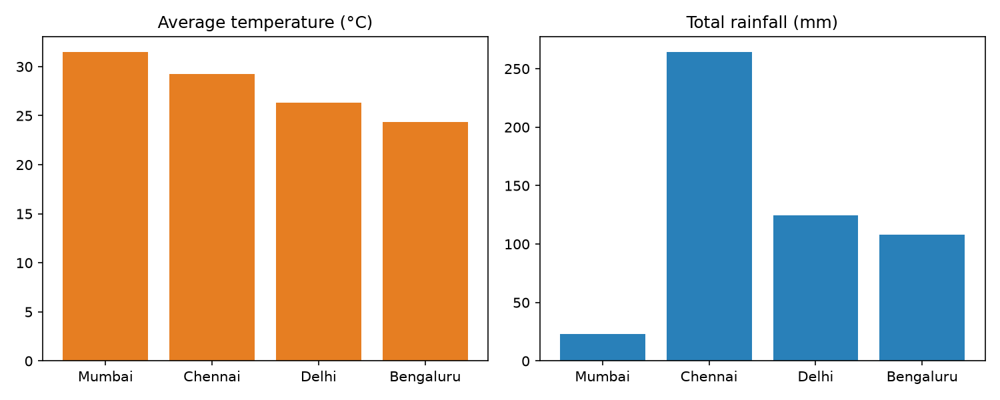

# Weather ETL Pipeline

A small end-to-end ETL pipeline that pulls 30 days of daily weather data for four Indian cities from the free [Open-Meteo API](https://open-meteo.com/), cleans it with Pandas, validates it, and loads it into SQLite for SQL analysis.

## Pipeline
API (JSON) -> Extract -> Transform (Pandas) -> Quality checks -> Load (SQLite) -> SQL analysis

## Tech
Python, Pandas, Requests, SQLite, SQL (GROUP BY, CTEs, window functions)

## What it does
- **Extract:** calls the API per city and saves the raw JSON.
- **Transform:** renames columns, fixes types, removes duplicates and nulls, adds average temperature.
- **Quality checks:** fails if data is empty, duplicated, null, or has impossible values.
- **Load:** writes to a SQLite table with a (city, date) primary key; safe to re-run.
- **Analyse:** `sql/queries.sql` has 5 queries (aggregation, JOIN with CTE, ROW_NUMBER, LAG).

## How to run
```bash
pip install -r requirements.txt
python src/pipeline.py
python src/run_queries.py
python src/make_chart.py
```

## Results


## Structure
```
src/pipeline.py      # extract, transform, quality checks, load
src/run_queries.py   # runs the SQL queries
sql/queries.sql      # analysis queries
data/                # raw JSON and weather.db (git-ignored)
src/make_chart.py    # creates the summary chart
```

## Possible improvements
Schedule with cron/Airflow, move to PostgreSQL, add unit tests.
